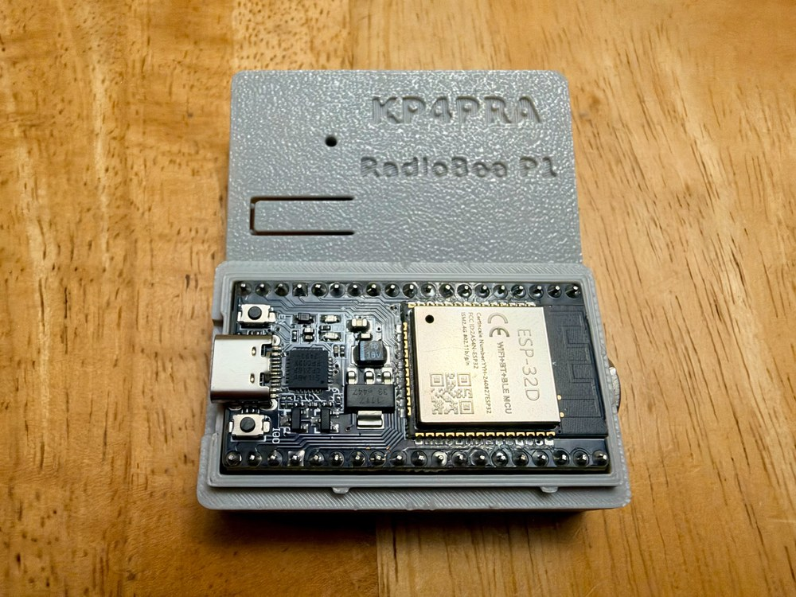

# RadioBee P1

<p align="center"></p>

**RadioBee P1** is a Bluetooth / Bluetooth Low Energy KISS TNC for amateur packet radio, APRS and Winlink, built on an
ESP32-WROOM-32. It connects a handheld or mobile radio (TRRS cable, DigiRig Lite-compatible) to phone and PC apps:

- **Classic Bluetooth (SPP)**: Windows COM port for PinPoint APRS, PuTTY and other KISS programs; Android APRSdroid.
- **Bluetooth Low Energy (BLE)**: KISS for aprs.fi and other BLE apps, plus a short configuration console.
- 1200 baud AFSK, AX.25 and FX.25 receive (decoded in parallel), FX.25 transmit for connected-mode frames.
- PTT safety: 5 s transmit time-out, over-long transmissions rejected, lockout after repeated trips.
- Settings saved on the device (FX.25 TX on/off, TX audio level).

### Tested with

| | |
|---|---|
| **APRS apps** | PinPoint APRS (Windows), APRSdroid (Android), aprs.fi (BLE) |
| **Winlink** | Winlink Express, RadioMail, WoAD |
| **Terminal** | PuTTY |
| **Handhelds** | Yaesu FT3D, AnyTone AT-D878UV, Baofeng UV-5R, Baofeng UV-17 Pro Max |
| **Mobiles** | Yaesu FTM-400, Alinco DR-135, TYT TH-9000D, Motorola CDM750, Motorola MaxTrac 300 |

And others. Set the TX audio level (TXDAC) for each radio; see the [user guide](docs/USER_GUIDE.md).

This repository contains:

- Compiled firmware binaries (on the [Releases](https://github.com/hebersoto/radiobee-releases/releases) page)
- Flashing instructions
- Parts list and build guide for the RadioBee P1 hardware
- Bug reports and support through GitHub Issues

## Current Release

**RadioBee P1 firmware v0.2.42**:
[download from Releases](https://github.com/hebersoto/radiobee-releases/releases/latest)

| File | Flash address | Use |
|---|---|---|
| `RadioBee_P1_v0.2.42_update_0x10000.bin` | `0x10000` | **Normal update.** Keeps your saved settings. |
| `RadioBee_P1_v0.2.42_full_0x0.bin` | `0x0` | Blank or unknown ESP32, or recovery. **Erases saved settings.** |

## How to Flash

Step-by-step guide (web flasher in Chrome/Edge, esptool, or Espressif Flash Download Tool):
[docs/HOW_TO_FLASH_RadioBee_P1.md](docs/HOW_TO_FLASH_RadioBee_P1.md)
(an HTML copy is attached to each release).

Quick update with esptool (replace `COM5` with your port):

```sh
esptool --chip esp32 -p COM5 -b 460800 write-flash 0x10000 RadioBee_P1_v0.2.42_update_0x10000.bin
```

## Using RadioBee

BOOT button, LEDs, USB console, Bluetooth (SPP) and BLE (nRF apps) consoles, and all settings:
[docs/USER_GUIDE.md](docs/USER_GUIDE.md)
(an HTML copy is attached to each release).

## Building a RadioBee P1

Parts list, wiring diagrams (RX, TX, PTT, TRRS jack), wire list and checks:
[docs/BUILD_GUIDE_RadioBee_P1.md](docs/BUILD_GUIDE_RadioBee_P1.md)

## What's New in 0.2.42

- All RadioBee text (USB console and Bluetooth console) lines up in PuTTY and other terminals with default settings.
- 0.2.40: Windows 11 pairs classic Bluetooth and gets a COM port; BLE uses its own address, so after updating from
  0.2.33 or older, select RadioBee again once in BLE phone apps. More free memory for Bluetooth.

## Support

Open an [issue](https://github.com/hebersoto/radiobee-releases/issues) with the firmware version (shown at boot and by
the `s` key on the USB console), the app and radio you use, and what happened.

## License and Source Code

RadioBee firmware is free software, licensed under the **GNU General Public License v2.0 or later** (see
[LICENSE](LICENSE)). It contains code derived from [Dire Wolf](https://github.com/wb2osz/direwolf) by John Langner,
WB2OSZ.

The complete corresponding source code for each released binary is available on request: open an
[issue](https://github.com/hebersoto/radiobee-releases/issues) in this repository. This written offer is valid for at
least three years after the last release of a given version.

RadioBee is a project of KP3M.
