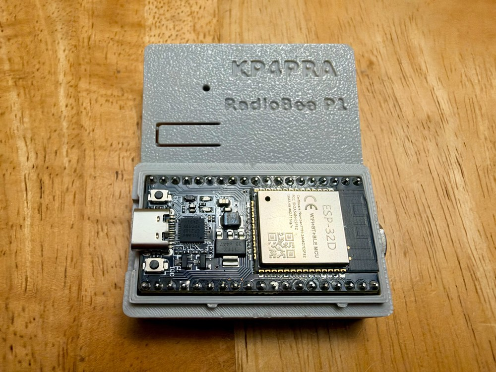

# RadioBee P1 — Parts List and Build Guide

How to build the RadioBee P1 radio interface: an ESP32-WROOM-32 DevKit board, a 3.5 mm TRRS jack and 14 small parts,
hand-wired with hook-up wire. After building, install the firmware with
[HOW_TO_FLASH_RadioBee_P1.md](HOW_TO_FLASH_RadioBee_P1.md) and see the [user guide](USER_GUIDE.md).

> **Kits:** parts, unassembled kits and assembled kits will be available at
> [kp4pra.praprs.com](https://kp4pra.praprs.com/) by December 2026.

<p align="center"></p>

> **Verify before you solder**
>
> - **TRRS jack lugs:** the lug numbers (1, 2, 3, 4 / J) differ between jack makers. Plug a TRRS plug in and check with
>   a meter (continuity) which lug goes to Tip, Ring 1, Ring 2 and Sleeve.
> - **Transistor pins:** BC547 is usually C-B-E, 2N3904 / 2N2222 / PN2222A are usually E-B-C. Check your part with its
>   datasheet or the meter's diode / hFE test before wiring.

---

## 1. Parts list

| [ ] | Ref | Qty | Value | Marking / how to recognize it | Where it goes |
|---|---|---|---|---|---|
| [ ] | DevKit | 1 | ESP32-WROOM-32 DevKit, 38-pin, CP2102 USB | BOOT + EN buttons, blue LED (status LED) | — |
| [ ] | J1 | 1 | 3.5 mm TRRS female jack, 4-pole | 4 contacts (Tip / Ring 1 / Ring 2 / Sleeve) | Radio cable |
| [ ] | Q1 | 1 | BC547 NPN transistor, TO-92 | "BC547" (2N2222 / 2N3904 work, different pinout) | PTT switch |
| [ ] | C1 | 1 | **47 pF** ceramic, C0G / NP0 | "470" or "47" | Tip lug → Sleeve lug |
| [ ] | C2 | 1 | **1 nF** ceramic | "102" | Ring 1 lug → Sleeve lug |
| [ ] | C3 | 1 | **1 nF** ceramic | "102" | Ring 2 lug → Sleeve lug |
| [ ] | C4 | 1 | **10 µF** electrolytic, 16 V or more | can with (−) stripe, **polarized** | Tip → R1, **(−) toward Tip** |
| [ ] | C5 | 1 | **1 µF** film, 63 V | "105", no polarity | GPIO25 → R6 |
| [ ] | C6 | 1 | **1 nF** ceramic | "102" | Q1 base → GND |
| [ ] | R1 | 1 | **1 kΩ** ¼ W | brown black red | C4 (+) → GPIO34 node |
| [ ] | R2 | 1 | **10 kΩ** ¼ W | brown black orange | GPIO34 node → 3V3 |
| [ ] | R3 | 1 | **10 kΩ** ¼ W | brown black orange | GPIO34 node → GND |
| [ ] | R4 | 1 | **2.2 kΩ** ¼ W | red red red | GPIO27 → Q1 base |
| [ ] | R5 | 1 | **100 kΩ** ¼ W | brown black yellow | Q1 base → GND |
| [ ] | R6 | 1 | **330 Ω** ¼ W | orange orange brown | C5 → Ring 1 lug (at the jack) |
| [ ] | R7 | 1 | **100 Ω** ¼ W | brown black brown | Q1 collector → Ring 2 lug |
| [ ] | — | — | Hook-up wire, about 30 cm | thin, solid or stranded | — |

**Count check:** 6 capacitors (1 × 47 pF, 3 × 1 nF, 1 × 10 µF, 1 × 1 µF), 7 resistors (100, 330, 1k, 2.2k, 10k,
10k, 100k), 1 transistor, 1 jack, 1 DevKit.

Parts, unassembled kits and assembled kits: [kp4pra.praprs.com](https://kp4pra.praprs.com/) (by December 2026).

**Also needed (not in the kit):**

- Radio cable, TRRS, **DigiRig Lite-compatible**, for your radio.
- USB cable for the DevKit (a **data** cable, not charge-only).
- Optional: 3D-printed enclosure (top cover + snap-fit bottom).

**Tools:** soldering iron (25 W is enough), solder, side cutters, wire stripper, multimeter.

---

## 2. ESP32 DevKit pins used

| DevKit pin | Function | Connects to |
|---|---|---|
| GPIO25 (DAC1) | TX audio out | C5 |
| GPIO34 (ADC1_CH6) | RX audio in | R1 / R2 / R3 node |
| GPIO27 | PTT drive | R4 |
| 3V3 | RX bias supply | R2 |
| GND | Common ground | R3, R5, C6, Q1 emitter, J1 Sleeve |

The status LED (GPIO2, blue LED) and the BOOT button (GPIO0) are already on the DevKit: nothing to wire.
Leave all other pins unconnected.

---

## 3. TRRS jack (female) — parts soldered directly on the lugs

Solder these three capacitors **on the jack lugs themselves**, leads as short as possible, each to the Sleeve (GND) lug.

```text
TRRS Female
============================

TIP / RX (2)
   |
  47pF  (C1)
   |
  GND


R1 / TX (3)
   |
  1nF   (C2)
   |
  GND


R2 / PTT (4)
   |
  1nF   (C3)
   |
  GND

GND - (1) (J) = Sleeve
```

Also on the jack:

- **R6 330 Ω** soldered to the **Ring 1 lug** (TX audio arrives through R6).
- **R7 100 Ω** soldered to the **Ring 2 lug** (PTT arrives through R7).
- **One short ground wire** from the Sleeve lug to DevKit **GND**.

| TRRS contact | Function | Lug (example, verify) |
|---|---|---|
| Tip | Radio audio out → RadioBee RX | 2 |
| Ring 1 | RadioBee TX audio → radio mic in | 3 |
| Ring 2 | PTT (pulled to GND to transmit) | 4 |
| Sleeve | Ground | 1 (J) |

---

## 4. RX audio (radio → GPIO34)

```text
                                          3V3
                                           |
                                          10k (R2)
                                           |
TIP (2) --+-- (-) 10uF (+) --- 1k ---------+--------- GPIO34
          |       (C4)        (R1)         |
         47pF (C1)                        10k (R3)
          |                                |
         GND                              GND
```

1. **C1 47 pF**: at the jack, Tip lug → Sleeve lug (section 3).
2. **C4 10 µF**: (−) lead to the Tip lug wire, (+) lead toward R1. The (−) side is marked with a stripe on the can.
3. **R1 1 kΩ**: from C4 (+) to the **bias node**.
4. **Bias node** (close to the DevKit): R1, R2, R3 and a short wire to **GPIO34**.
5. **R2 10 kΩ**: bias node → **3V3**.
6. **R3 10 kΩ**: bias node → **GND**.

Check: with no radio connected and the board powered, GPIO34 to GND ≈ **1.65 V**.

---

## 5. TX audio (GPIO25 → radio)

```text
GPIO25 --- 1uF film (C5) --- 330R (R6) --- RING1 / TX (3)
                                                  |
                                                 1nF (C2)
                                                  |
                                                 GND
```

1. **C5 1 µF film**: one lead to **GPIO25** (short wire), other lead to the wire going to the jack. No polarity.
2. **R6 330 Ω**: at the jack, one lead on the **Ring 1 lug**, the other to the wire from C5.
3. **C2 1 nF**: at the jack, Ring 1 lug → Sleeve lug (section 3), on the jack side of R6.

R6 and C2 keep the radio's RF out of the TX audio. The audio level is set in firmware (TXDAC, default 10); set it
for correct FM deviation, not by ear.

---

## 6. PTT (GPIO27 → radio PTT)

```text
                                  RING2 / PTT (4) --- 1nF (C3) --- GND
                                        |
                                      100R (R7)
                                        |
                                        C
GPIO27 --- 2.2k (R4) ---+------------ B    Q1 BC547
                        |               E
                        |               |
                        |              GND
                        |
                        +--- 100k (R5) --- GND
                        |
                        +--- 1nF  (C6) --- GND   (beside Q1)
```

1. **Q1** near the DevKit. Identify B, C and E on **your** part first (see the warning at the top).
2. **R4 2.2 kΩ**: GPIO27 → Q1 base.
3. **R5 100 kΩ** and **C6 1 nF**: both from Q1 base to GND, right at the transistor.
4. **Q1 emitter** → GND.
5. **Q1 collector** → wire to the jack → **R7 100 Ω** on the **Ring 2 lug**.
6. **C3 1 nF**: at the jack, Ring 2 lug → Sleeve lug (section 3).

GPIO27 HIGH turns Q1 on and pulls the radio's PTT line to ground. The firmware limits each transmission to 5 s.

---

## 7. Ground

All grounds meet at DevKit **GND**: R3, R5, C6, Q1 emitter and the jack **Sleeve** lug. The radio and the RadioBee
must share this ground, otherwise PTT and audio do not work.

---

## 8. Wire list (from → to)

| # | From | To | Part in between |
|---|---|---|---|
| 1 | J1 Tip lug | J1 Sleeve lug | C1 47 pF |
| 2 | J1 Ring 1 lug | J1 Sleeve lug | C2 1 nF |
| 3 | J1 Ring 2 lug | J1 Sleeve lug | C3 1 nF |
| 4 | J1 Sleeve lug | DevKit GND | wire |
| 5 | J1 Tip lug | C4 (−) | wire |
| 6 | C4 (+) | Bias node | R1 1 kΩ |
| 7 | Bias node | DevKit 3V3 | R2 10 kΩ |
| 8 | Bias node | DevKit GND | R3 10 kΩ |
| 9 | Bias node | DevKit GPIO34 | wire |
| 10 | DevKit GPIO25 | R6 | C5 1 µF film |
| 11 | R6 | J1 Ring 1 lug | R6 330 Ω (at the lug) |
| 12 | DevKit GPIO27 | Q1 base | R4 2.2 kΩ |
| 13 | Q1 base | DevKit GND | R5 100 kΩ |
| 14 | Q1 base | DevKit GND | C6 1 nF |
| 15 | Q1 emitter | DevKit GND | wire |
| 16 | Q1 collector | J1 Ring 2 lug | R7 100 Ω (at the lug) |

---

## 9. Checks after building

**Before power (meter, board unplugged):**

1. 3V3 to GND: no short.
2. Tip, Ring 1, Ring 2 each to Sleeve: no short (the capacitors read open after a moment).
3. Sleeve lug to DevKit GND: continuity.
4. C4 polarity: (−) toward Tip.

**With USB power, no radio:**

1. GPIO34 to GND ≈ **1.65 V**.
2. Flash the firmware ([HOW_TO_FLASH_RadioBee_P1.md](HOW_TO_FLASH_RadioBee_P1.md)).
3. DevKit blue LED steady on.
4. USB console (115200 baud), press `s`: firmware version and `BT/BLE Name: RadioBee P1-XXXX`.

**With the radio:**

1. Connect an app (APRSdroid, PinPoint, aprs.fi) and send a beacon: the radio keys and the LED stays on during TX.
2. Listen on a second receiver; adjust TXDAC for clean audio and correct deviation ([user guide](USER_GUIDE.md)).
3. Receive: keep the radio volume low to medium (about ¼ on a Baofeng). Too loud clips the input.

---

## Support

Open an [issue](https://github.com/hebersoto/radiobee-releases/issues) with a photo of your wiring, the firmware
version, the radio and what happened.
