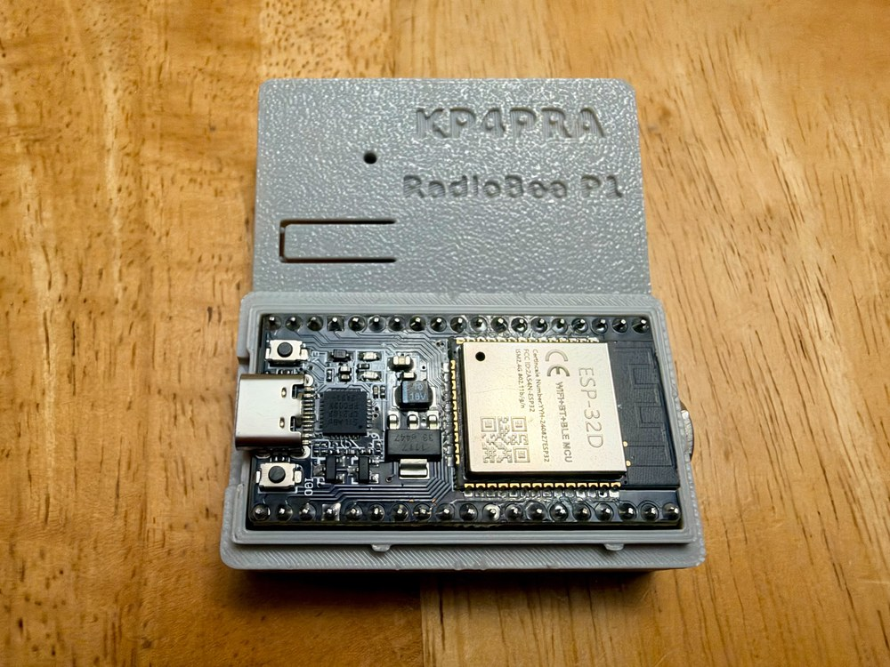

# RadioBee P1 — User Guide (firmware v0.2.42)

How to use and configure a RadioBee P1: the BOOT button, the LEDs, the USB console, and the Bluetooth (SPP) and
Bluetooth Low Energy (BLE) consoles. To install or update the firmware, see
[HOW_TO_FLASH_RadioBee_P1.md](HOW_TO_FLASH_RadioBee_P1.md).

<p align="center"></p>

## 1. Connections

- **Radio:** TRRS cable, DigiRig Lite-compatible (Tip = radio audio out, Ring1 = TX audio to the radio,
  Ring2 = PTT, Sleeve = ground).
- **Power / USB:** the ESP32 board's USB port. It also gives a USB serial console.
- **Apps:**
  - Classic Bluetooth (SPP): PinPoint APRS and other KISS programs on Windows (Bluetooth COM port), APRSdroid on Android.
  - BLE: aprs.fi and other apps with BLE KISS.

The device name is **`RadioBee P1-XXXX`** (XXXX = last 4 hex digits of the board's ID). It is the same for classic
Bluetooth and BLE, and it never changes, not even after a factory reset.

### Tested with

| | |
|---|---|
| **APRS apps** | PinPoint APRS (Windows), APRSdroid (Android), aprs.fi (BLE) |
| **Winlink** | Winlink Express, RadioMail, WoAD |
| **Terminal** | PuTTY |
| **Handhelds** | Yaesu FT3D, AnyTone AT-D878UV, Baofeng UV-5R, Baofeng UV-17 Pro Max |
| **Mobiles** | Yaesu FTM-400, Alinco DR-135, TYT TH-9000D, Motorola CDM750, Motorola MaxTrac 300 |

And others. Set the TX audio level (TXDAC) for each radio (section 4).

Only **one classic Bluetooth client** and **one BLE client** can be connected at a time. Disconnect the KISS app
before you open a console on the same link.

## 2. LEDs

| LED | Meaning |
|---|---|
| Steady on | Running, no Bluetooth client connected |
| Fast flashing | A classic Bluetooth or BLE client is connected |
| Steady on while transmitting | PTT active |

Both LEDs show the same thing.

## 3. BOOT button

The **BOOT** button changes settings while the RadioBee is running. It is ignored while transmitting.

> Do **not** hold BOOT while you power up or press EN/RST: that starts the ESP32 in firmware download mode.

| Action | Result | LED answer |
|---|---|---|
| 1 short press | TX audio level (TXDAC) +1, saved | 1 long flash |
| 2 short presses | TX audio level (TXDAC) −1, saved | 2 long flashes |
| Hold about 1 s (LEDs go dark), release before 10 s | Toggle hybrid FX.25 transmit, saved | ON: 3 quick + 1 long · OFF: 1 long + 3 quick |
| Hold 10 s (5 very quick flashes = armed), then release | **Factory reset** of the settings, then reboot | 5 very quick flashes |
| Press at the end of the range | Level not changed | 4 very quick flashes |

Factory reset sets FX.25 TX = ON and TXDAC = 10. The device name does not change.

## 4. Settings

| Setting | Default | Range | Saved |
|---|---|---|---|
| TXDAC (TX audio level to the radio) | 10 | 1 … 60 | Yes |
| FX.25 TX (hybrid) | ON | ON / OFF | Yes |
| RX threshold | firmware default | 10 … 4095 | No (until reboot) |

- **TXDAC:** raise or lower it until your radio's FM deviation is correct (about 3 kHz for 1200 baud packet).
  Too high distorts the audio; too low is not decoded. Check with a second receiver or a deviation meter.
- **FX.25 TX (hybrid):** when ON, connected-mode data frames are sent as FX.25 (forward error correction);
  APRS and all other frames are always plain AX.25. Receive always decodes AX.25 and FX.25.

## 5. USB console

1. Connect the RadioBee by USB. Use the CP210x COM port (Windows Device Manager → *Ports (COM & LPT)*;
   Mac `/dev/cu.usbserial-*`; Linux `/dev/ttyUSB0`).
2. Open a terminal (PuTTY → *Serial*, or the Arduino Serial Monitor): **115200 baud, 8N1, no flow control**.
   PuTTY default settings work.
3. Press a single key, **no Enter needed**:

| Key | Action |
|---|---|
| `s` | Status (firmware, name, settings, connections, memory) |
| `d` | RX diagnostics |
| `f` | FX.25 diagnostics |
| `x` | Toggle FX.25 TX (saved) |
| `+` / `-` | TXDAC +1 / −1 (saved) |
| `]` / `[` | RX threshold +10 / −10 (not saved) |
| `b` | Pause BLE for 120 s (press again to resume) |
| `?` | Help |

Opening the USB port can restart the board; that is normal for ESP32 DevKit boards.

## 6. Bluetooth (SPP) console

The classic Bluetooth link carries KISS for apps and also accepts text commands.

1. Pair **`RadioBee P1-XXXX`** from your PC or phone. If a PIN is asked, use **1234**.
2. **Windows:** *Settings → Bluetooth & devices → More Bluetooth settings → COM Ports → Add → Outgoing*,
   choose RadioBee. Open that COM port in PuTTY (*Serial*, any speed). PuTTY default settings work.
   **Android:** use an app such as "Serial Bluetooth Terminal".
3. Close PinPoint, APRSdroid or any other app that uses the RadioBee over classic Bluetooth first.
4. Type a command (section 8) and press **Enter**.

## 7. BLE console (nRF apps)

The BLE link gives a short text console through the Nordic UART Service.

**nRF Toolbox → UART** (easiest): connect to `RadioBee P1-XXXX` and send commands as text.

**nRF Connect:**

1. Scan and connect to `RadioBee P1-XXXX`.
2. Open the **Nordic UART Service** `6E400001-B5A3-F393-E0A9-E50E24DCCA9E`.
3. Enable notifications on **TX** `6E400003-B5A3-F393-E0A9-E50E24DCCA9E` (replies arrive here).
4. Write text (UTF-8) to **RX** `6E400002-B5A3-F393-E0A9-E50E24DCCA9E`, for example `S`.

Notes:

- Replies are short, one line per notification. `FULL` and `GET ALL` are refused over BLE; use USB or SPP for those.
- Only one BLE app at a time: disconnect aprs.fi (or any other BLE app) first.
- BLE apps for packet use the separate BLE KISS service `00000001-BA2A-46C9-AE49-01B0961F68BB`.
- After updating from firmware 0.2.33 or older, select the RadioBee again once in BLE apps (its BLE address changed).

## 8. Console commands (SPP and BLE)

Commands are not case-sensitive. An optional `RB ` prefix is accepted (`RB S` = `S`).
Each reply ends with a line starting with `OK` or `ERR`. Changes are refused while transmitting.

| Command | Action |
|---|---|
| `S` or `STATUS` [`FULL`] | Status |
| `D` or `DIAG` [`FULL`] | RX diagnostics |
| `F` or `FX` [`FULL`] | FX.25 diagnostics |
| `I` or `INFO` [`FULL`] | Device information |
| `GET` [`ALL`] | Show settings |
| `GET TXDAC` / `FX25` / `RXTHR` / `ID` / `NAME` / `MAC` / `FW` | Show one value |
| `SET TXDAC <1..60>` | Set TX audio level (saved) |
| `SET FX25 ON` / `OFF` / `TOGGLE` | FX.25 TX (saved) |
| `SET RXTHR <10..4095>` | RX threshold (not saved) |
| `X`, `+`, `-`, `]`, `[` | Same as the USB keys |
| `FACTORY RESET`, then `FACTORY RESET CONFIRM` | Factory reset of the settings (confirm within 30 s on the same link) |
| `?` or `HELP` | Command list |

Example:

```text
SET TXDAC 12
OK TXDAC=12 SAVED
```

## 9. Transmit safety

- A transmission is cut after **5 seconds** (time-out timer).
- Transmissions longer than 4 seconds are rejected before keying.
- After 3 time-outs within 5 minutes, transmit is locked out until the RadioBee is restarted (power off/on or EN/RST).

## 10. Support

Open an [issue](https://github.com/hebersoto/radiobee-releases/issues) with the firmware version (USB `s` or
console `GET FW`), the app and radio you use, and what happened.
